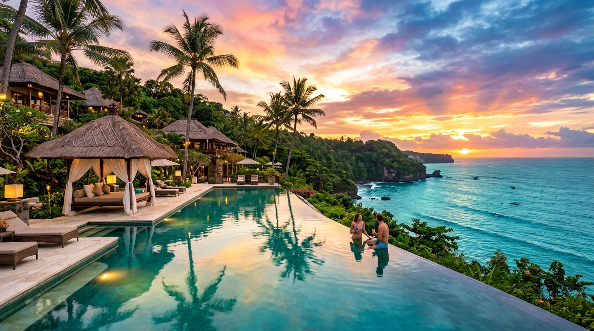

# 🌴 SelamatVn Travel & Tours — Luxury Travel Agency Landing Page

A modern, vibrant, and fully responsive travel agency landing page built to showcase curated vacation packages and compel travelers to book their dream vacations.



---

## ✨ Features

- **🎨 Vibrant & Colorful Modern Aesthetic**: Curated color palette (Caribbean Cyan, Sunset Coral, Tropical Emerald, and Sunlit Gold) with glassmorphism, micro-animations, and rich typography.
- **📱 100% Mobile & Tablet Responsive**: Optimized for desktops, tablets (iPads), and smartphones with mobile drawer navigation, animated toggle, and swipeable category pills.
- **🔍 Interactive Hero Trip Finder**: Instant package discovery by destination, travel style, season, and group size.
- **🧳 Filterable Curated Packages Grid**: Interactive filter tabs (*Beach & Tropical, Luxury Escapes, Alpine Adventure, Cultural Heritage, Wildlife Safari*) with real-time keyword search.
- **💳 Multi-Step "Join Package" Booking Modal**:
  - **Step 1**: Package overview & highlights.
  - **Step 2**: Guaranteed departure dates, guest counter, room upgrade, and flight bundle.
  - **Step 3**: Lead traveler details, special requests, and 20% deposit vs. full payment options.
  - **Step 4**: Confetti celebration with a printable **Digital Boarding Pass Ticket Voucher** and unique booking reference (`WL-2026-XXXXX`).
- **📊 Real-Time Custom Trip Estimator**: Live calculator allowing users to customize hotel tiers, add VIP excursions (yacht cruise, helicopter tour, private chef), and see instant discounted group totals.
- **🗺️ Day-by-Day Itinerary Modal**: Visual timeline of daily activities, 100% inclusions, and optional upgrades.
- **💬 24/7 VIP Concierge Chat**: Floating interactive assistant with quick prompt buttons and instant responses.
- **🔥 Live Social Proof Ticker**: Real-time toast notifications of recent bookings worldwide.
- **💱 Multi-Currency Switcher**: Real-time currency conversions for USD ($), EUR (€), GBP (£), and AUD (A$).

---

## 📁 Project Structure

```
├── index.html            # Semantic HTML5 markup with SEO & accessibility
├── styles.css            # Vanilla CSS design system (responsive, glassmorphism)
├── app.js                # Interactive logic (booking engine, calculator, currency converter)
├── assets/
│   └── images/           # High-resolution destination visuals & traveler portraits
│       ├── hero-bali.jpg
│       ├── amalfi-coast.jpg
│       ├── swiss-alps.jpg
│       ├── kyoto-japan.jpg
│       ├── serengeti-safari.jpg
│       ├── santorini-greece.jpg
│       ├── avatar-couple.jpg
│       └── avatar-traveler.jpg
└── README.md
```

---

## 🚀 Getting Started

Simply open `index.html` in any modern web browser or serve locally:

```bash
# Using Python
python -m http.server 8080

# Using Node.js / npx
npx serve .
```

Then visit `http://localhost:8080`.

---

## 📄 License

MIT License © 2026 SelamatVn Travel & Tours. All rights reserved.
